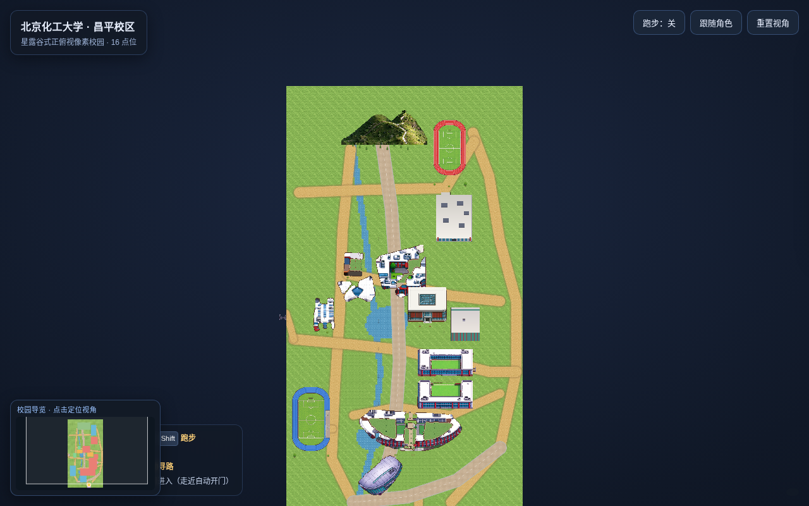
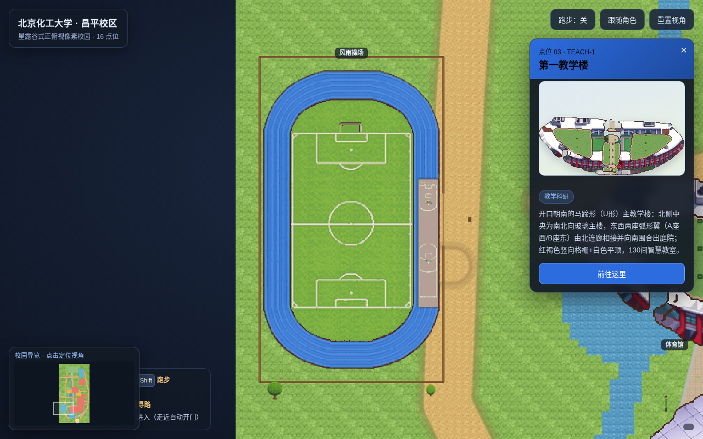
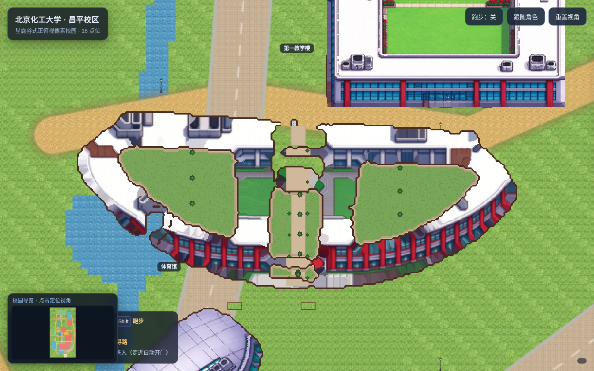
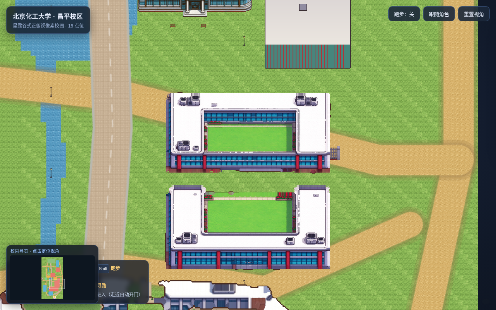
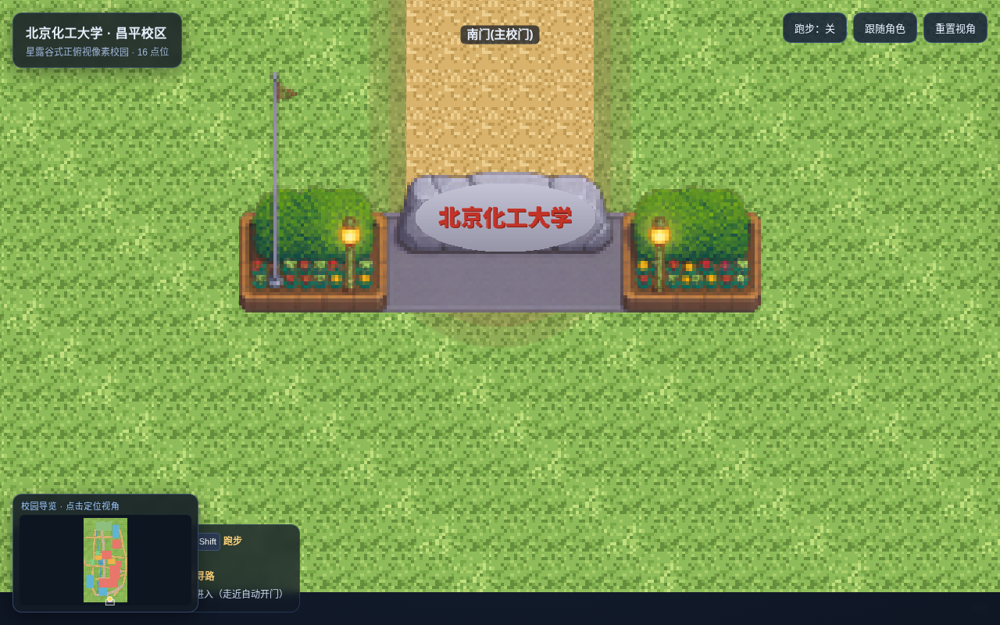
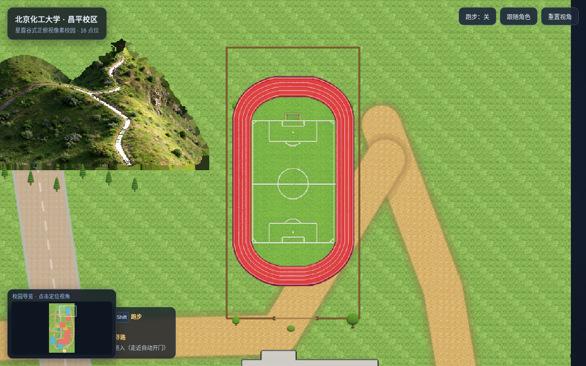
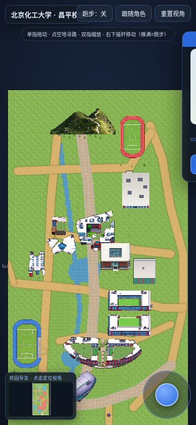
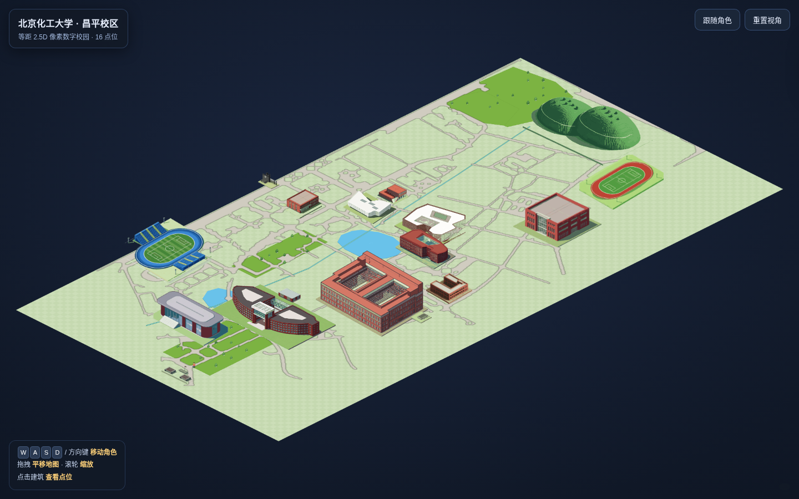

# 北化数字校园 · Digital Campus

> 基于官方平面图与真实照片，把北京化工大学昌平校区做成一座**可漫步、可寻路的像素校园**：16 个真实点位、一个能走能跑的 chibi 角色，零依赖网页双击即开，同一份数据还同源产出 Cocos Creator 3.8 工程。

一个可直接运行的**纯前端像素地图**：按官方平面图还原 16 个核心点位的写实材质像素建筑与 11 条真实道路，支持拖拽 / 缩放浏览、点位信息卡（含像素配图）、四方向走 / 跑角色、方格 BFS 自动寻路、操场围栏唯一入口的门开合动画、建筑名标签、小地图导航，以及手机 / 平板竖屏适配。当前线上为 **v2.5「星露谷式正俯视（top-down 方形瓦片）」**版本；初代 **v1「等距 2.5D 菱形」**资产与 Cocos 工程一并保留。两端由同一份权威数据经脚本同源导出，坐标与点位完全一致。

`零第三方运行时依赖` · `纯前端可离线 file:// 运行` · `GitHub Pages 推送即部署` · `网页 + Cocos 双端同源`

---

## 界面速览

<table>
  <tr>
    <td align="center" width="50%"><b>校园全貌 · 正俯视</b><br><sub>16 点位 + 11 条真实道路，山体 / 水系 / 草坪按真实位置排布</sub></td>
    <td align="center" width="50%"><b>点位信息卡</b><br><sub>编号 / 名称 / 分类 / 简介 + 立体像素配图，一键「前往这里」</sub></td>
  </tr>
  <tr>
    <td></td>
    <td></td>
  </tr>
  <tr>
    <td align="center"><b>第一教学楼 · 马蹄形特写</b><br><sub>U 形主楼 + 弧形翼 + 空中连廊，放大后顶部显示名称标签</sub></td>
    <td align="center"><b>实验楼群 · 方形合院</b><br><sub>按官方平面图重做为 2×2 口字合院，严格贴地块</sub></td>
  </tr>
  <tr>
    <td></td>
    <td></td>
  </tr>
  <tr>
    <td align="center"><b>南门（主校门）</b><br><sub>校名石碑 + 花坛灯杆，南门敞开式中轴入场</sub></td>
    <td align="center"><b>北操场 · 围栏唯一入口</b><br><sub>红跑道 + 足球场四周围栏，仅一门可进，旁为玉屏山</sub></td>
  </tr>
  <tr>
    <td></td>
    <td></td>
  </tr>
  <tr>
    <td align="center"><b>移动端竖屏 · 虚拟摇杆</b><br><sub>标题 / 按钮 / 信息卡自适应重排，右下摇杆推满即跑</sub></td>
    <td align="center"><b>初代等距 2.5D（v1 存档）</b><br><sub>菱形投影 + 红砖建筑，资产保留于 img/sprites，Cocos 工程沿用</sub></td>
  </tr>
  <tr>
    <td></td>
    <td></td>
  </tr>
</table>

> 更多分阶段实景 / 官方图对比见 `03_地图预览器/screenshots_td/`（含 `shape_official_vs_scene/`、`roads_beforeafter/`、`scale_beforeafter/` 等校准对照），等距版截图见 `03_地图预览器/screenshots/`。

---

## 1. 快速启动

环境：纯静态 HTML / CSS / 原生 JavaScript，**无需安装任何框架或第三方包**；本地服务器只用 Python 3 或 Node.js 自带标准库。

### 1.1 在线访问（最省事）

浏览器直接打开，电脑手机均可，无需安装：

**<https://Guzifeng0613.github.io/digital-campus/>**

由 `.github/workflows/deploy.yml` 在每次 push 到 `main` 后自动发布；首次开启需在仓库 **Settings → Pages → Source** 选择 **GitHub Actions**。

### 1.2 本地运行（网页预览器，开箱即用）

```bash
# 1）进入网页预览器目录
cd '03_地图预览器'

# 2）启动零依赖本地服务器（二选一，无需 pip / npm install）
python3 server.py            # 优先：Python 3 标准库，默认 http://127.0.0.1:8090/
node server.js               # 兜底：Node.js 标准库，默认 http://127.0.0.1:8080/
# 端口被占用会自动顺延；也可手动指定：python3 server.py 9000
```

启动后自动打开浏览器，并打印局域网地址，**同一 WiFi 下的手机 / 平板也能访问**。也可直接双击三平台一键脚本，或直接双击 `index.html` 纯离线打开（无局域网共享）：

| 系统 | 一键启动 | 直接离线 |
|---|---|---|
| Windows | `启动网页端.bat` | 双击 `index.html` |
| macOS | `启动网页端.command`（被 Gatekeeper 拦截时右键 → 打开） | 双击 `index.html` |
| Linux | `./启动网页端.sh` | 双击 `index.html` |

### 1.3 操作方式

| 操作 | 功能 |
|---|---|
| `W A S D` / 方向键 | 控制角色移动，相机自动跟随 |
| 按住 `Shift` / 跑步开关 | 跑步（移速更快、切换跑步帧、带扬尘粒子） |
| 鼠标拖拽 / 单指拖动 | 平移地图 |
| 滚轮 / 双指捏合 | 以指针 / 双指中点为中心缩放 |
| 右下角虚拟摇杆（仅触屏） | 无键盘时控制行走，推满 = 跑步 |
| 点击建筑 | 弹出点位信息卡（编号 / 名称 / 分类 / 介绍 + 配图） |
| 点击空地 / 信息卡「前往这里」 | 自动寻路走到该点（操场会走进唯一门内） |
| 左下角小地图 | 实时位置 / 视野框 / 寻路路线，点击直接飞行定位 |
| 放大地图 | 建筑顶部显示名称标签 |
| 「跟随角色 / 重置视角」 | 回到跟随视角 / 整校园全貌 |

**场地围栏**：风雨操场（蓝跑道、中间纯草地）、北操场（红跑道 + 足球场）四周设围栏，**只能从唯一的门进入**；角色走近时像素门自动打开、进入瞬间显示「进入 · 场地名」横幅，离开后自动闭合。东、西校门为门楼 + 伸缩门分体，靠近时伸缩门收拢放行。教学楼、实验楼、体育馆、食堂、校门为实体碰撞（可贴墙滑动），操场、玉屏山等开敞场地可进入。

### 1.4 Cocos Creator 3.8 工程

1. Cocos Dashboard → 添加 → 选择 `04_Cocos工程/`，用 **3.8.x** 打开（小版本兼容，提示版本不一致选「仍要打开」）。
2. 场景中创建空节点并命名 `Campus`，把 `assets/scripts/CampusBootstrap.ts` 挂到该节点。
3. 保存场景后点击 ▶ 预览——引导脚本会自动创建 Canvas、正交相机、地图、角色、HUD 与全部交互，无需手动拖节点。
4. 完整步骤（含拷进空工程的兜底方法与控制台自检）见 `04_Cocos工程/README.md`。

---

## 2. 核心交互如何落地

| 交互能力 | 本项目的实现 | 可演示入口 |
|---|---|---|
| 地图浏览 | 相机平移、以指针为中心缩放、全貌居中、跟随角色、重置视角 | 拖拽 / 滚轮 / 双指 / 顶部按钮 |
| 点位信息卡 | 16 点位元数据 + 透明底立体像素配图 + 文字简介，含「前往这里」 | 点击任意建筑 |
| chibi 角色 | 4 方向 ×（idle + 走 4 帧 + 跑 4 帧）= **36 帧**；AABB 滑墙碰撞、按深度自动遮挡、走路 bob / 跑步前倾 / 扬尘 | `WASD`、方向键、触屏摇杆 |
| 自动寻路 | **方格 BFS**：4 向 + 对角且不穿墙角，目标被挡取最近可达点；实时虚线、终点标记、卡住自检、手动取消 | 点空地 / 「前往这里」 |
| 围栏与校门 | 两操场围栏唯一入口 + 像素门开合 + 进入横幅；东西校门伸缩门接近收拢，寻路 / 碰撞同步放行 | 走近门自动触发 |
| 建筑名标签 | 缩放超过阈值后在建筑顶部显示，随视野裁剪 | 滚轮放大 |
| 小地图导航 | 缩略底图 + 分类色点 + 角色脉冲 + 当前视野框 + 寻路路线，点击飞行定位 | 左下角小地图 |
| 移动端适配 | 竖 / 横屏响应式重排、更大触控目标、禁用浏览器默认手势与双击缩放、虚拟摇杆 | 手机 / 平板浏览器 |

**设计说明**：逻辑网格 `gx,gy` 与投影彻底解耦，切换投影时代换的只是渲染内核，点位坐标、碰撞与道路数据不变；网页端不接任何外部服务或 GPU，所有逻辑在浏览器本地确定性运行。

---

## 3. 16 个核心点位

| 分类 | 点位 |
|---|---|
| 教学科研 | 第一教学楼（马蹄形 U 楼 + 空中连廊）、第二教学楼、实验楼群（方形合院）、文理楼、泰瑞楼（工程训练中心） |
| 公共服务 | 图书馆、大学生活动中心 |
| 体育 | 风雨操场、体育馆、北操场 |
| 餐饮 | 玉兰食堂、紫竹食堂 |
| 校门 | 南门（主校门）、东门、西门 |
| 自然地标 | 玉屏山 |

每栋建筑均含唯一 `id`、编号、分类、地块 `grid`、碰撞体、锚点 / 缩放与文字简介，详见 `03_地图预览器/js/data.js` 与权威源 `02_地图工程/build/campus_data.py`。

---

## 4. 目录结构

```
digital-campus/
├── 01_资料与参考/          # 官方平面图、卫星 / 实景照片、手绘草图与编号、外形校准素材
├── 02_地图工程/
│   ├── build/              # 权威数据模型 campus_data.py + 建模 / 像素化 / 切帧 / 导出 / 校验脚本
│   └── assets/
│       ├── sprites/        # 等距版 16 点位透明底像素资产（按分类分目录）
│       ├── preview/source/ # 单体预览图、建模参考
│       ├── catalog/        # 图鉴与总体排布资产
│       └── manifest.json   # 资产清单
├── 03_地图预览器/          # 零依赖网页端（当前线上版本）
│   ├── index.html          # 入口：HUD、信息卡、小地图、加载层、移动端适配
│   ├── server.py/server.js # 标准库本地服务器（Python 优先 / Node 兜底）
│   ├── 启动网页端.bat/.command/.sh
│   ├── js/
│   │   ├── data.js         # 16 点位元数据（地块 / 碰撞 / 简介 / 配图，自动导出）
│   │   ├── topdown_data.js # 自动生成：道路 / 水系 / 自然地块网格折线（勿手改）
│   │   └── main.js         # 投影、渲染、相机、输入、角色、碰撞、BFS、门动画、小地图
│   ├── img/topdown/        # sprites 35 · tiles 10 · decor 17 · doors 37 · player 36 帧
│   ├── screenshots/        # 等距 v1 截图
│   └── screenshots_td/     # 俯视 v2 截图与实景对比
├── 04_Cocos工程/           # Cocos Creator 3.8：resources/ + scripts/ + 接入 README
├── 05_文档/                # 像素插图提示词手册、PR 说明、线上验证截图
├── docs/                   # topdown 渲染契约、worktree 分支拓扑
├── .github/workflows/deploy.yml
├── *.zip                   # 三个特定版本打包快照（以目录源码与 CHANGELOG 为准）
├── CHANGELOG.md
└── README.md
```

---

## 5. 数据与资产流水线

- **唯一事实源**：`02_地图工程/build/campus_data.py` 统管 16 点位的坐标、占地、朝向、分类与描述。
- **同源双端导出**：数据经脚本生成网页 `js/data.js` 与 Cocos `assets/scripts/CampusData.ts`，保证两端 16 点位 id、坐标完全一致；道路 / 水系折线由 `gen_topdown_data.py` 生成进 `js/topdown_data.js`。
- **资产流水线**：真实照片校准轮廓 → 2.5D / 俯视建模渲染 → AI 像素化（限定色板与 4px 艺术颗粒）→ 透明底抠图 → 按 `分类/ID` 规范归档；角色由精灵表自动抠绿、切帧、对齐。

| 脚本（`02_地图工程/build/`） | 职责 |
|---|---|
| `gen_map_data.py` / `gen_topdown_data.py` | 导出网页等距 / 俯视数据与道路折线 |
| `export_web_assets.py` | 导出网页端图片资产 |
| `gen_cocos.py`（配 `04_Cocos工程/tools/`） | 生成 Cocos 数据与资源 |
| `gen_player_frames.py` / `gen_chibi_frames.py` | 主角 / chibi 角色切帧 |
| `pixelate.py` / `crop_subject.py` | 限定色板像素化、透明底主体抠图 |
| `render_*.py` / `compose.py` | 建模渲染、单体 / 目录 / 总体排布出图 |
| `roads_extract.py` / `check_scale.py` | 道路提取、重叠 / 压路 / BFS 校验 |

---

## 6. 技术要点

- **网格与投影解耦**：逻辑网格 `gx,gy`（gx 向东、gy 向南）独立于渲染。当前俯视版锁定 `TILE = 48 px`、艺术颗粒 `GRAIN = 4 px`（1/12 tile），世界坐标 `world(gx,gy) = (gx×48, gy×48)`，深度排序 `depth = gy×1000 + gx`；网格范围 gx `6…144`、gy `6…271.2`，世界尺寸约 `6624 × 12730 px`。
- **建筑对齐**：每栋建筑用地块矩形 `grid=[fx,fy,fw,fh]` + 锚点 `ANCHOR_AX/AY` + 缩放 `ISO_K`，把立体 sprite 南缘中点对齐到地块，按深度排序形成前后遮挡。
- **自动寻路**：俯视版为方格 BFS（4 向 + 对角不穿墙角、AABB 滑墙、卡住自检、围栏唯一门缺口放行）；初代等距版采用旋转坐标 BFS（`u=gx+gy, v=gx−gy`）沿菱形道路搜索。
- **Cocos 运行时加载**：资源走 `resources.load` 按路径加载，不依赖编辑器 `.meta` UUID，导入即用；一个 `CampusBootstrap` 引导脚本自动生成整张地图。
- **零依赖服务器**：`server.py` / `server.js` 仅用标准库，含正确 MIME、路径穿越防护、端口占用自动顺延与局域网地址打印。

---

## 7. 双视角与版本演进

| 版本线 | 视角 / 投影 | 资产与状态 |
|---|---|---|
| **v2.0 – v2.5（topdown）** | 星露谷式正俯视，方形瓦片 `world=(gx×48,gy×48)`，3/4 高角度立体建筑 | `img/topdown/`（sprites / tiles / decor / doors / player），**当前网页与 GitHub Pages 线上版本**，契约见 `docs/topdown-spec.md` |
| **v1.x（iso 2.5D）** | 等距菱形投影，菱形真实路网底图 + 红砖像素楼 | `img/ground.png`、`img/sprites/` 保留原位不删、不再被线上引用；`04_Cocos工程/` 沿用此版数据与资源 |

> 说明：Cocos 工程对应初代等距版。若要在 Cocos 中呈现最新俯视效果，需以 `03_地图预览器/img/topdown/` 与 `js/` 为准，按 `docs/topdown-spec.md` 同步资源并替换投影内核。

---

## 8. 测试与质量验证

- **网页端 Playwright 自动化遍历**：桌面鼠标点击 / 滚轮缩放 / 拖拽平移 / `WASD` 全通过；模拟 iPhone 竖屏 `390×844` 与横屏 `844×390` 触摸，覆盖点建筑弹卡、双指外扩 / 捏合、摇杆移动、信息卡，**console 零 JS 错误、无失败请求**，捏合不会误触发点击。
- **寻路可达性**：南门出发到全部 16 点位 BFS 均可达、零穿实体楼与墙角；两个操场唯一门开合与进入横幅、东西校门开闸回归通过。
- **资产 / 美术质检**：`check_scale.py` 做重叠 / 压路 / BFS 校验；多轮轮廓重画执行双遍质检（10/10 PASS）与独立双盲美术评，零品红、四角透明。
- **Cocos 端**：TypeScript 静态检查（`tsc`）零错误，网页与 Cocos 16 点位 id、坐标一致；真机运行仍建议在编辑器预览确认。
- **CI 现状**：`.github/workflows/deploy.yml` 目前承担 GitHub Pages 自动部署；上述功能测试为本地 Playwright / Python 脚本与各版 CHANGELOG「回归」记录，仓库内暂未配置自动化测试流水线。

---

## 9. 部署到 GitHub Pages

```yaml
# .github/workflows/deploy.yml（要点）
on:
  push:
    branches: [main]
    paths: ['03_地图预览器/**', '.github/workflows/deploy.yml']
  workflow_dispatch:
```

工作流检出代码后把 `03_地图预览器/` 复制为 `site/`，并 `rm -rf ./site/screenshots`（开发截图不上线），再经 `configure-pages` → `upload-pages-artifact` → `deploy-pages` 发布。同刻仅保留一次部署（concurrency group `pages`）。首次使用在仓库 **Settings → Pages → Source** 选 **GitHub Actions** 即可，发布地址为 **<https://Guzifeng0613.github.io/digital-campus/>**。

---

## 10. 资源、版权与隐私

- 建筑外形依据**官方平面图、卫星 / 实景照片与手绘编号草图**（见 `01_资料与参考/`），像素图为项目原创的艺术化加工（AI 像素化 + 人工多轮校形），不含第三方扫描件或受版权保护的现成贴图。
- 网页端**不依赖任何第三方 npm / pip 运行时包**，以原生 HTML / CSS / JavaScript 实现；Cocos 端仅依赖 Cocos Creator 3.8 引擎。
- 纯前端、无后端数据库、无账号体系、无埋点分析、无外部网络接口；除 GitHub Pages 托管本身外不发起任何请求，`file://` 双击即可完全离线运行。
- 本地服务器仅在本机 / 局域网提供静态文件，含路径穿越防护，不上传任何数据。

---

## 11. 已知边界

1. `04_Cocos工程/` 为 v1 等距 2.5D 接入版，最新星露谷俯视效果请以网页端为准；Cocos 同步需自行迁移 `img/topdown/` 资源并替换投影逻辑。
2. Cocos 引擎真机 / 浏览器表现需在 Cocos Creator 3.8.x 编辑器内预览确认，自动化仅覆盖静态类型检查。
3. 直接双击 `index.html`（`file://`）不支持局域网手机访问，个别浏览器对本地文件限制较严时请改用 `server.py` / `server.js`。
4. 像素建筑为艺术化还原而非测绘级精度，点位坐标、占地与朝向以 `campus_data.py` 为准。
5. 自动化测试基于桌面与移动设备模拟（Playwright），未覆盖全部真实机型与浏览器。
6. 仓库根目录三个 `.zip` 为特定版本打包快照，最新内容以各工作目录源码与 `CHANGELOG.md` 为准。

---

## 12. 版本记录

本项目遵循语义化版本（SemVer），完整变更见 [CHANGELOG.md](CHANGELOG.md)。

| 版本 | 日期 | 要点 |
|---|---|---|
| `2.5.0-topdown` | 2026-10-19 | 风雨操场改纯草地、围栏场地自动进门、移动端竖屏 3 处修复、锚点调试钩子 |
| `2.4.0-topdown` | 2026-10-19 | 实验楼按官方平面图重做为方形合院，footprint 改方形，修通东门通道 |
| `2.3.0-topdown` | 2026-10-18 | 8 栋 sprite 美术做满 + 轮廓精修，双盲评 PASS |
| `2.2.0-topdown` | 2026-10-18 | 10 栋建筑轮廓按官方平面图重画，双遍质检 10/10 |
| `2.1.0-topdown` | 2026-10-18 | 路网 8 → 11 条、建筑尺度饱满化、新增 `check_scale.py` |
| `2.0.0-topdown` | 2026-10-18 | 整体改星露谷正俯视：方形内核 + 16 栋 sprite + 主角 36 帧 + 围栏门逻辑 |
| `1.2.0` | 2026-10-18 | 移动端响应式 / 双指捏合 / 虚拟摇杆 + GitHub Actions 自动部署 |
| `1.1.0` | 2026-10-18 | 零依赖本地服务器 + 三平台一键启动 + 开箱即用交付包 |
| `1.0.0` | 2026-10-18 | 首版等距 2.5D 像素校园，网页 + Cocos 双端六大功能 |

### 文档导航

| 文档 | 内容 |
|---|---|
| `CHANGELOG.md` | 语义化版本更新日志与每版回归记录 |
| `docs/topdown-spec.md` | top-down 渲染契约：网格 / 投影 / 尺寸 / 命名 / 光向 / 色板 |
| `docs/worktree-branches.md` | top-down 改造期 worktree 与并行分支拓扑 |
| `03_地图预览器/README.md` | 网页端启动、操作、目录、坐标与场地逻辑 |
| `04_Cocos工程/README.md` | Cocos 导入、挂载引导脚本、预览自检 |
| `05_文档/像素插图提示词手册.md` | 像素资产 AI 生成提示词规范 |
| `02_地图工程/assets/manifest.json` | 像素资产清单与归档 |
